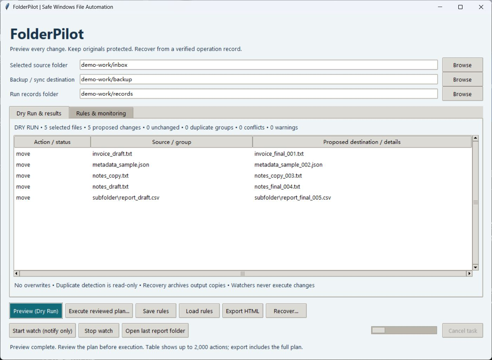

# FolderPilot

v0.1.1 patch: exported preview reports require the same separate directory scope as execution records. FEATURES.md is included in the Windows package.
### Safe offline Windows file automation

Organize repetitive file work with a plan you can review before anything changes. FolderPilot is a small English desktop tool for operations teams, agencies and clients needing custom Python or Windows automation.

**Automate:** batch rename with replacements/regex/numbering, organize by type/date/size, detect SHA-256 duplicates, create verified backups, and run version-preserving incremental sync. Monitor selected folders without automatic changes.

**Try it:** extract the portable ZIP and run `FolderPilot/FolderPilot.exe`. Keep the entire folder together. Source users can run `python run_app.py` with Python 3.12 and tkinter; no pip runtime dependency is needed. Run `python run_app.py --demo` for a synthetic, neutral-path demonstration.

**Customize it:** save reusable JSON rules or adapt the compact Python engine for a client's naming scheme and file workflow. No cloud account, API key, telemetry, startup task or system service is used.



[Rules and monitoring](docs/screenshots/rules.jpg) · [Read-only duplicate detection](docs/screenshots/duplicates.jpg)

## The workflow

1. Select the source folder you authorize FolderPilot to scan. For backup/sync, select a separate non-overlapping destination. Select a separate folder for execution/recovery records.
2. Choose a task and rules, then click **Preview (Dry Run)**. This only reads files and computes hashes. Review proposed destinations, conflicts and warnings.
3. Click **Execute reviewed plan…** and confirm the exact scope and operation count. Changed settings or files require a new preview. Existing destination files are never overwritten.
4. Keep the run folder with `journal.json` and `report.html`. Use **Recover…** to preview restoration. Changed/conflicting files remain for manual review; eligible copies are archived rather than permanently discarded.

Duplicate detection is read-only. Export its HTML report; the application has no duplicate-delete action. Folder watchers are explicitly started in the app and only notify you to preview again.

## What the safety rules mean

- Rename/organize use a streamed copy followed by SHA-256 verification before the original directory entry is removed. Failed copies leave the original and a journal describing partial output. Recovery never overwrites an occupied source path.
- All copies use exclusive creation. A conflict appearing after preview stops the operation rather than overwriting the destination. Whole-plan validation runs before the first mutation, and each source is checked again before copying.
- A durable journal records ownership of newly created outputs, copy completion and operation completion. On cancellation or failure, already completed operations remain recorded; this is recoverable execution, not an all-or-nothing transaction.
- Recovery copies eligible output into `recovered-files/` before removing its previous entry. For moves, it also restores the original location if free. Data remains available; archive copies and empty directories are intentionally retained.
- Backup makes a fresh `backup-TIMESTAMP-ID` snapshot. Incremental sync is **one-way and version-preserving**: identical files are skipped; changed files get `.fp-HASH` siblings. Earlier destination versions and destination-only files remain untouched. It does not mirror deletions or overwrite the canonical old filename.
- Only the explicitly selected source is recursively scanned. Backup/sync inspect only corresponding paths under the explicitly selected target. Symbolic links, junctions, other reparse points and hard-linked files are excluded and reported.
- Filters apply to extension, byte size and inclusive UTC modification dates. Original modification timestamps are preserved on copies; ACLs, alternate data streams and full filesystem metadata are outside this content-backup contract.

See [QUICK_START.md](QUICK_START.md), [FEATURES.md](FEATURES.md). The included tests and build workflow provide validation evidence.

## Development and packaging

```powershell
python -m venv .venv
.venv\Scripts\python -m pip install -r requirements-dev.txt
.venv\Scripts\python -m pytest -q -W error
.venv\Scripts\python scripts/verify_gui.py
powershell -ExecutionPolicy Bypass -File scripts/build_windows.ps1
```

The Windows build runs regression tests, a real Tk preview/execute/recover integration, a packaged GUI launch and a packaged functional probe operating only on its own temporary samples. GitHub Actions tests Python 3.12 on Windows/Linux and builds the portable Windows ZIP. Published Windows packages include a SHA256SUMS file in Releases. The package is unsigned.

## Practical boundaries

Use quiet local data directories during execution. Hash/stat checks detect ordinary external changes but do not provide filesystem snapshots, OS locks against hostile concurrent writers, or power-loss transactions. A forced process kill can leave partial files; keep the journal and review them. Recovery refuses altered content and uncertain output ownership. Never edit a journal or recover from an untrusted record.

Planning retains file/action metadata and duplicate groups in memory; file bytes are streamed in 1 MiB chunks. Very large inventories may require smaller selected scopes. Python regex rules are intended for trusted local patterns and do not have a hard evaluation timeout. Watching polls size/mtime, so an edit preserving both may not be noticed; execution still rehashes sources. Windows long paths, permissions, locked files, encrypted files, cloud placeholders and network filesystem behavior may limit a job and are reported rather than bypassed.

No fabricated clients, testimonials or commercial results are claimed. MIT for the original application; see [THIRD_PARTY_NOTICES.md](THIRD_PARTY_NOTICES.md).

## Public snapshot

Version 0.1.1. This repository contains the runnable source, synthetic examples, tests, build scripts and neutral-path real screenshots. Internal acceptance records and previous private history are excluded. [Releases](https://github.com/BigCity-SmallLove/folderpilot-showcase/releases) lists only packages that have completed publication checks.
